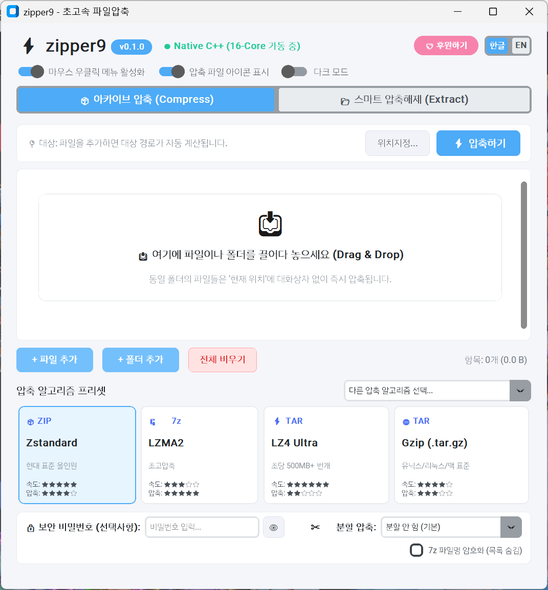

# zipper9 (초경량 다중 포맷 압축/해제기) - v1.0.0

<div align="center">

<p>
  <b><a href="README.md">English</a></b> • <b>한국어 (Korean)</b>
</p>

[](LICENSE)
[](LICENSE)
[](#-빠른-설치-및-실행-가이드-quick-install--run)
[](#-개발자-후원하기-sponsor)

**Python Fluent UI와 고성능 C/C++ 네이티브 멀티코어 엔진이 결합된 크로스 플랫폼 초경량·초고속 압축기**  
*초경량 번들, Zstandard / LZ4 / LZMA2 알고리즘, Windows 11 모던 우클릭 메뉴 완벽 지원*

[스크린샷](#-스크린샷) • [주요 특징](#-주요-특징) • [설치 가이드](#-빠른-설치-및-실행-가이드-quick-install--run) • [FAQ / 문제 해결](#-자주-묻는-질문-및-문제-해결-faq) • [후원하기](#-개발자-후원하기-sponsor) • [라이선스](#-라이선스-license)

</div>

---

## 🌟 주요 특징

### 🖥️ 스크린샷

| 라이트 모드 (Light Mode) | 다크 모드 (Dark Mode) |
| :---: | :---: |
|  |  |

1. **초경량 모던 UI (CustomTkinter)**:
   - 20MB 내외의 가벼운 번들 크기, 즉각적인 반응 속도, 세련된 다크/라이트 테마.
   - **드래그 앤 드롭 (Drag & Drop)** 파일/폴더 추가 및 ZIP/7z/TAR 아카이브 즉시 열기 지원.
   - 목록에서 잘못 추가한 항목을 **`[✕]` 버튼으로 개별 제거** 가능.
   - **한국어 / English 실시간 언어 전환** 지원.
2. **다양한 압축 포맷 및 알고리즘 완벽 지원**:
   - **ZIP 아카이브 (`.zip`)**:
     - `Zstandard (zstd)`: Meta의 현대적 고속/고압축 알고리즘 (기본 압축, 압축 3~5배, 해제 5~10배 빠름).
     - `무압축 (Store)`: 동영상/이미지 등 이미 압축된 대용량 파일 초고속(수 초 내) 패키징.
   - **7-Zip 아카이브 (`.7z`)**:
     - `7z: LZMA2 (표준)`: 7-Zip 네이티브 멀티코어 엔진 기반 고속 표준 압축.
   - **TAR 아카이브 (유닉스 / 리눅스 / macOS 표준)**:
     - `TAR: .tar.lz4`: **LZ4 초고속 아카이브** (RAM 대역폭 급 해제 속도, 대용량 백업 및 게임 에셋 최적화).
     - `TAR: .tar.gz`: Gzip 표준 배포판 포맷 (전 세계 유닉스/리눅스/맥 공통 표준).
     - `TAR: .tar.xz`: 최신 리눅스 커널/배포판 패키지 표준 포맷 (XZ / LZMA2).
     - `TAR: .tar.bz2`: 고전 리눅스 아카이브 포맷 (Bzip2).
     - `TAR: .tar`: 무압축 Tarball 패키징.
3. **아카이브 미리보기 및 안전한 해제**:
   - 압축 해제 전 내부 파일 목록, 원본 크기, 압축 크기 및 용량 절감률(%) 실시간 분석.
   - Zip-Slip / Tar-Slip 디렉터리 탈출 취약점 방어 로직 내장.
   - 스마트 단일 루트 폴더 중복 압축 해제 방지(반디집 스타일) 지원.
4. **압축 후 자동 무결성 검사 (Integrity Verification)**:
   - 상단 옵션의 **`[압축 후 무결성 검사]`**를 활성화하면, 압축 완료 직후 7-Zip 네이티브 검증(`7z t`) 및 CRC32/SHA 무결성 검사를 자동 수행하여 중요 파일의 100% 온전함을 보증합니다.

---

## 📊 지원 포맷 요약 (Supported Formats)

`zipper9`은 초고속 현대 압축 알고리즘부터 가상 디스크 이미지, 리눅스 시스템 패키지까지 광범위한 포맷을 지원합니다.

### 1. 압축하기 (Creation / Compression) 지원 포맷

| 포맷 및 규격 | 확장자 | 압축 엔진 및 주요 특징 | 지원 옵션 |
| :--- | :--- | :--- | :--- |
| **ZIP (Zstandard)** | `.zip` | Meta Zstandard 네이티브 멀티스레드 압축 (표준 대비 압축 3~5배, 해제 5~10배 빠름, **기본값**) | 암호화(AES-256), 분할 압축, 무결성 검증 |
| **ZIP (Store)** | `.zip` | 무압축 고속 패키징 (이미 압축된 동영상/사진 수 초 내 초고속 묶기) | 암호화(AES-256), 분할 압축, 무결성 검증 |
| **7-Zip (LZMA2)** | `.7z` | 7-Zip C++ 멀티코어 표준 고압축 엔진 | 암호화(AES-256), **파일명 암호화(헤더 숨김)**, 분할 압축, 무결성 검증 |
| **TAR (LZ4 Ultra)** | `.tar.lz4` | RAM 버스 대역폭 급 초고속 압축 (대용량 백업 및 게임 에셋 최적화) | 무결성 검증 (`lz4 -t`) |
| **TAR (Gzip)** | `.tar.gz`, `.tgz` | Unix / Linux / macOS 범용 표준 배포판 포맷 | 암호화, 분할 압축, 무결성 검증 |
| **TAR (XZ)** | `.tar.xz`, `.txz` | 최신 리눅스 커널 및 배포판 패키지 표준 고압축 포맷 | 암호화, 분할 압축, 무결성 검증 |
| **TAR (Bzip2)** | `.tar.bz2`, `.tbz2` | 전통 유닉스 고압축 포맷 | 암호화, 분할 압축, 무결성 검증 |
| **TAR (Raw)** | `.tar` | 무압축 Tarball 패키징 | 암호화, 분할 압축, 무결성 검증 |
| **ISO (UDF 2.60)** | `.iso` | 광학/가상 디스크 이미지 (UDF 2.60 마스터링, 4GB+ 대용량 파일 및 유니코드 보존) | 무결성 검증 (`7z t`), 탐색기 즉시 마운트 |

### 2. 압축풀기 (Extraction / Decompression) 지원 포맷 (총 46종)

| 분류 | 지원 포맷 | 지원 확장자 | 특징 및 설명 |
| :--- | :--- | :--- | :--- |
| **표준 압축** | `ZIP`, `ZIPX`, `7Z`, `RAR`, `RAR5`, `TAR`, `CAB`, `WIM`, `SFX(EXE)` | `.zip`, `.zipx`, `.7z`, `.rar`, `.tar`, `.cab`, `.wim`, `.sfx`, `.sfx.exe` | WinZip 고압축 ZIPX, RAR/RAR5, 윈도우 WIM/CAB, 자동 풀림 SFX 등 완전 지원 |
| **Unix / Linux 계열** | `GZ`, `TGZ`, `BZ`, `BZ2`, `TBZ`, `TBZ2`, `XZ`, `TXZ`, `LZMA`, `TLZ`, `Z`, `TAZ`, `DEB`, `UDEB`, `RPM`, `CPIO`, `ARJ` | `.gz`, `.tgz`, `.bz`, `.bz2`, `.tbz`, `.tbz2`, `.xz`, `.txz`, `.lzma`, `.tlz`, `.z`, `.taz`, `.deb`, `.udeb`, `.rpm`, `.cpio`, `.arj` | Debian/Ubuntu `.deb`, RedHat `.rpm`, 전통 Unix `.z`/`.arj` 등 리눅스 패키지 및 스트림 원클릭 해제 |
| **가상 디스크 이미지** | `ISO`, `IMG`, `BIN`, `UDF`, `DMG`, `PKG`, `XIP`, `VHD`, `VHDX`, `VMDK`, `VDI`, `QCOW2` | `.iso`, `.img`, `.bin`, `.udf`, `.dmg`, `.pkg`, `.xip`, `.vhd`, `.vhdx`, `.vmdk`, `.vdi`, `.qcow2` | ISO 9660/Joliet/UDF, Apple DMG/PKG, Hyper-V, VMware, VirtualBox, QEMU 가상머신 디스크 이미지 무마찰 파일 추출 |
| **인스톨러 / 시스템** | `Compound (MSI, MSP, MSM)`, `NSIS`, `PE` | `.msi`, `.msp`, `.msm`, `.nsis`, `.exe` | Windows Installer 설치 패키지 및 Nullsoft 인스톨러 내부 리소스 무손실 추출 |
| **구형 아카이브** | `LHA`, `LZH`, `ALZ` | `.lha`, `.lzh`, `.alz` | 고전 일본 LHA/LZH 및 알집 ALZ (100% 오픈소스 `unalz` 탑재로 기업에서도 안전) |
| **초고속 현대 알고리즘** | `ZSTD`, `LZ4` | `.zst`, `.tar.zst`, `.lz4`, `.tar.lz4` | RAM 대역폭 속도의 초고속 멀티스레드 스트림 해제 |
| **❌ 미지원 포맷 안내** | `EGG` | `.egg` | **이스트소프트(ESTsoft)의 독점 라이선스(상업적 재배포 제한) 이슈로 지원 대상에서 배제** |

---

## 📦 멀티플랫폼 바이너리 배포 지원 (Multi-Platform Binaries)

`zipper9`은 사용자의 데스크톱 환경에 맞춘 공식 바이너리 배포 패키지를 제공합니다.  
| 운영체제 | 패키지 포맷 | 특징 및 지원 내용 |
| :--- | :--- | :--- |
| **Windows 11 / 10** | `zipper9.exe`<br>`zipper9_shell.msix` | • 무설치 단일 독립 실행 바이너리 (18MB)<br>• Windows 11 모던 1단계 최상위 우클릭 메뉴 (Rust COM DLL)<br>• Windows 10 클래식 메뉴 및 파일 확장자 아이콘 연동 |
| **Debian / Ubuntu / Raspberry Pi** | `zipper9_1.0.0_amd64.deb`<br>`zipper9_1.0.0_arm64.deb`<br>`zipper9-v1.0.0-linux-*.tar.gz` | • x86_64(`amd64`) 및 ARM64(`arm64`, Raspberry Pi 4/5, AWS Graviton) 네이티브 지원<br>• 원클릭 `.deb` 설치 및 완전 독립 단독 실행 포터블 바이너리 제공<br>• 시스템 패키지(`7zip`, `lz4`, `zstd`)와 자동 연동<br>• XDG 데스크톱 앱 런처 및 파일 관리자(Nautilus) 통합 |
| **macOS** | `zipper9-1.0.0.dmg`<br>`zipper9.app` | • Apple Silicon (M1~M4) 및 Intel Universal 지원<br>• `/Applications` 드래그 앤 드롭 설치<br>• Homebrew 기반 고속 엔진 자동 바인딩 |

---

## 📁 디렉터리 구조

```text
zipper9/
├── requirements.txt            # Python 의존성 (CustomTkinter, WinDND 등)
├── main.py                     # 애플리케이션 진입점
├── zipper9.rb                  # Homebrew Cask 패키지 레시피 (macOS)
├── zipper9.spec                # PyInstaller 단일 바이너리 패키징 스펙
├── run.bat                     # 원클릭 실행 배치 파일
├── tools/                      # 100% C/C++ 네이티브 고속 엔진 및 쉘 확장 번들
│   ├── 7z/                     # 7-Zip 멀티코어 엔진 (7z.exe, 7z.dll)
│   ├── lz4/                    # LZ4 초고속 엔진 (lz4.exe)
│   ├── zstd/                   # Zstandard 초고속 엔진 (zstd.exe)
│   └── modern_shell/           # Windows 11 모던 1단계 우클릭 쉘 확장 번들
├── assets/                     # 전용 3D 아카이브 아이콘 (.ico, .png)
├── images/                     # UI 미리보기 스크린샷
├── tests/                      # 기능 및 CI/CD 무결점 테스트 스위트
└── zipper9_ui/                 # Python 모던 Fluent GUI
    ├── app.py                  # CustomTkinter 메인 애플리케이션
    └── bridge/                 # 워커, 설정, 다국어, 쉘 확장 브리지
```

---

## 🚀 빠른 설치 및 실행 가이드 (Quick Install & Run)

각 운영체제 터미널(CLI)에서 명령어 한 줄로 설치하거나 실행할 수 있습니다.

### 1. 윈도우 (Windows 11 / 10)
- **WinGet 패키지 설치**:
  ```powershell
  winget install smin987.zipper9
  ```
- **CLI 터미널 실행 (GUI 창 즉시 실행)**:
  ```powershell
  zipper9
  # 또는 특정 파일/폴더를 바로 열 때
  zipper9 sample.zip
  zipper9 C:\data\my_folder
  ```
- **포터블 바이너리**: [GitHub Releases](https://github.com/smin987/zipper9/releases)에서 `zipper9.exe`를 다운로드하여 더블 클릭 실행.

### 2. 데비안 / 우분투 / 라즈베리 파이 (Debian / Ubuntu / Raspberry Pi)
- **APT 패키지 설치 (amd64)**:
  ```bash
  curl -sLO https://github.com/smin987/zipper9/releases/download/v1.0.0/zipper9_1.0.0_amd64.deb && sudo apt install -y ./zipper9_1.0.0_amd64.deb && rm zipper9_1.0.0_amd64.deb
  ```
- **APT 패키지 설치 (arm64 - Raspberry Pi 4/5, Graviton 등)**:
  ```bash
  curl -sLO https://github.com/smin987/zipper9/releases/download/v1.0.0/zipper9_1.0.0_arm64.deb && sudo apt install -y ./zipper9_1.0.0_arm64.deb && rm zipper9_1.0.0_arm64.deb
  ```
- **단독 실행 포터블 바이너리 (.tar.gz)**:
  [GitHub Releases](https://github.com/smin987/zipper9/releases)에서 아키텍처에 맞는 `zipper9-v1.0.0-linux-*.tar.gz` 다운로드 후 압축 해제하여 `./zipper9` 즉시 실행.
- **CLI 터미널 실행 (GUI 창 즉시 실행)**:
  ```bash
  zipper9
  # 파일/폴더 자동 연동
  zipper9 sample.zip
  zipper9 ./my_project
  ```

### 3. 맥OS (macOS Apple Silicon & Intel)
- **Homebrew Cask 설치 (별도 탭 개설 불필요)**:
  ```bash
  brew install --cask https://raw.githubusercontent.com/smin987/zipper9/main/zipper9.rb
  ```
- **CLI 터미널 실행 (GUI 창 즉시 실행)**:
  ```bash
  zipper9
  # 또는 macOS 표준 앱 열기
  open -a zipper9
  ```
- **DMG 직접 설치**: [GitHub Releases](https://github.com/smin987/zipper9/releases)에서 `zipper9-v1.0.0-macos.dmg`를 다운로드하여 `/Applications`로 드래그 & 드롭.

---

## ❓ 자주 묻는 질문 및 문제 해결 (FAQ)

### Q. [Windows] `zipper9.exe` 포터블 파일을 직접 삭제했는데 우클릭 메뉴가 여전히 남아있습니다.
**A.** Windows 탐색기(모던 1단계 패키지 및 사용자 레지스트리)에 등록된 쉘 확장 설정 때문입니다.  
프로그램 파일을 이미 삭제하셨더라도 **PowerShell**을 열고 아래 명령어를 복사하여 실행하시면 등록된 모든 패키지와 레지스트리 잔재가 즉시 깨끗하게 제거됩니다:

```powershell
Get-AppxPackage *zipper9* | Remove-AppxPackage -ErrorAction SilentlyContinue; Remove-Item -Path "HKCU:\Software\Classes\*\shell\zipper9_compress", "HKCU:\Software\Classes\Directory\shell\zipper9_compress", "HKCU:\Software\Classes\Directory\Background\shell\zipper9_open", "HKCU:\Software\zipper9" -Recurse -Force -ErrorAction SilentlyContinue
```

> *💡 macOS와 Linux 환경은 앱(`zipper9.app`)을 휴지통에 넣거나 패키지(`apt remove`) 삭제 시 운영체제가 잔재를 자동으로 정리하므로 해당되지 않습니다.*

---

## 💖 개발자 후원하기 (Sponsor)

**zipper9**은 누구나 자유롭게 사용할 수 있는 **무료 소프트웨어(Source-Available Freeware)**입니다.  
프로그램이 유용하셨거나 지속적인 개발과 유지보수를 응원하고 싶으시다면 커피 한 잔의 따뜻한 후원을 부탁드립니다! 여러분의 따뜻한 응원은 프로젝트를 유지하고 발전시키는 데 매우 큰 힘이 됩니다. ☕✨

<div align="center">

[](https://github.com/sponsors/smin987)
[](https://www.buymeacoffee.com/smin987)
[](https://ko-fi.com/smin987)

</div>

---

## 📜 라이선스 및 제3자 오픈소스 고지 (License & Legal)

본 프로젝트(`zipper9`)는 **[zipper9 Fair-Code License Agreement](LICENSE)** (Source-Available & Freeware Software License)에 따라 배포됩니다.

### 1. zipper9 소프트웨어 라이선스 정책
- **바이너리 파일 (Compiled Binaries)**:
  - 개인, 학교/교육기관, 비영리단체 및 **기업(상업적 업무 환경 포함) 모두 완전 무료**로 영구 사용하실 수 있습니다.
- **개인 연구 및 기여 (Individual Research & PRs)**:
  - 개인 개발자는 학습, 연구, 버그 분석 및 [공식 저장소](https://github.com/smin987/zipper9) 기여(Pull Request) 목적으로 소스코드를 자유롭게 열람하고 로컬에서 수정할 수 있습니다.
- **경쟁 소프트웨어 출시 금지 (No Competing Products)**:
  - 본 소스코드를 활용하여 경쟁 압축/해제 유틸리티 소프트웨어 또는 서비스를 개발, 출시, 배포하는 행위는 엄격히 금지됩니다.
- **영리단체 및 기업 사용자의 소스코드 수정 금지 (No Corporate / Commercial Modification)**:
  - 영리단체, 기업체, 법인 및 소속 사용자(임직원 등)는 소스코드를 임의로 수정·변조·패치하거나 파생 버전을 생성할 수 없으며, 사내외 배포 또한 엄격히 금지됩니다 (영리/기업 환경에서는 공식 컴파일 바이너리 사용만 허용).
- **영리 목적의 배포 및 재판매 금지 (No Commercial Distribution)**:
  - 본 소프트웨어를 유료로 판매, 대여하거나 상업적 이익을 목적으로 배포할 수 없습니다.

### 2. 주요 아카이브 포맷 및 제3자 라이선스 준수 원칙
`zipper9`은 사용자와 기업 고객의 법적 안전성을 최우선으로 고려하여 철저한 라이선스 준수 원칙을 적용하고 있습니다:

- **ALZ 포맷 지원 및 unalz 라이선스 (기업 및 공공기관 100% 무료 보증)**:
  - 알집(ALZip) 독자 규격인 ALZ(`.alz`, `.a00`) 아카이브 해제는 Kippler 님이 개발한 100% 순수 오픈소스 엔진인 **`unalz` (zlib/libpng 라이선스)**를 기반으로 작동합니다.
  - zlib/libpng 라이선스는 상업적 업무 환경을 포함하여 어떠한 제약 없이 자유롭게 사용 및 재배포가 가능하므로, **기업체, 공공기관 및 관공서에서도 알툴즈 라이선스 단속이나 저작권 침해 우려 없이 완전 무료**로 안전하게 사용할 수 있습니다.
- **EGG 포맷 배제 사유 (Legal Risk Zero 원칙)**:
  - 알집의 EGG 포맷(`.egg`)은 제작사(이스트소프트)의 독점 라이선스(상업적 목적의 무단 구현 및 재배포 제한 조항)로 인해, 기업 사용자의 잠재적 저작권 분쟁 및 컴플라이언스 리스크를 원천 차단하기 위해 **zipper9의 지원 대상에서 영구 배제**되었습니다.
- **독점 포맷(RAR)의 압축 생성 미지원 원칙**:
  - RAR 포맷은 Alexander Roshal의 상용 독점 지적재산권이 적용되므로, 독점 압축 생성 알고리즘은 일절 구현하지 않으며 7-Zip의 오픈소스 UnRAR 모듈을 통한 **읽기 전용 압축 해제(Decompression)** 기능만 안전하게 제공합니다.

### 3. 번들된 제3자 오픈소스 소프트웨어 라이선스 요약
| 컴포넌트 | 경로 및 모듈 | 저작권자 / 프로젝트 | 적용 라이선스 | 비고 |
| :--- | :--- | :--- | :--- | :--- |
| **7-Zip & unRAR** | `tools/7z/7z.exe`, `7z.dll` | Igor Pavlov, Alexander Roshal | GNU LGPL v2.1+ (unRAR restriction) | 멀티스레드 네이티브 아카이브 엔진 |
| **unalz** | `tools/unalz/unalz.exe` | Kippler | **zlib/libpng License** | ALZ 전용 완전 자유 오픈소스 해제 엔진 |
| **LZ4** | `tools/lz4/lz4.exe` | Yann Collet | BSD 2-Clause (lib) / GNU GPL v2.0 (CLI) | 독립 프로세스 IPC 연동 초고속 스트림 |
| **Zstandard** | `tools/zstd/zstd.exe` | Meta Platforms, Inc. | BSD 3-Clause License | 초고속 멀티스레드 압축 엔진 |
| **CustomTkinter** | Python GUI Framework | Tom Schimansky | CC0 1.0 Universal / MIT License | 모던 Fluent GUI 프레임워크 |
| **Rust Crates** | `zipper9_shell.dll` | The Rust Project Contributors | MIT License / Apache License 2.0 | Windows 11 모던 쉘 확장 모듈 |

각 외부 도구의 상세 라이선스 원문 전문은 **[THIRD_PARTY_LICENSES.md](THIRD_PARTY_LICENSES.md)** 문서를 참조해 주시기 바랍니다.
