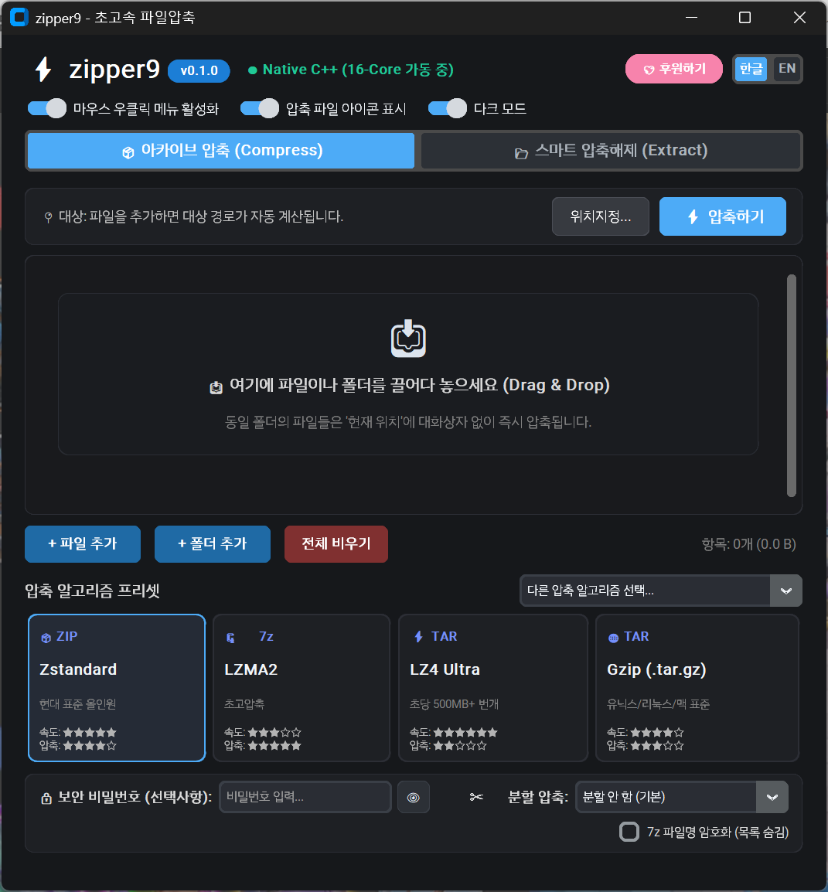

# zipper9 (초경량 다중 포맷 압축/해제기) - v1.0.0

<p align="center">
  <b><a href="README.md">English</a></b> | <b>한국어</b>
</p>

Python(CustomTkinter UI)과 고성능 C/C++ 네이티브 멀티코어 엔진(7-Zip, LZ4, Zstandard)을 결합한 초경량·초고속 무손실 압축 유틸리티입니다.  
**Windows 11, Debian Linux, macOS 3대 데스크톱 플랫폼 바이너리 배포를 공식 지원합니다.**  
**ZIP, 7-Zip(`.7z`), RAR, 그리고 리눅스/유닉스 주요 압축 포맷(`.tar.gz`, `.tar.xz`, `.tar.bz2`, `.tar.lz4`, `.tar`)을 완벽 지원합니다.**

---

## 🌟 주요 특징

### 🖥️ 스크린샷

| 라이트 모드 (Light Mode) | 다크 모드 (Dark Mode) |
| :---: | :---: |
|  |  |

1. **초경량 모던 UI (CustomTkinter)**:
   - 20MB 내외의 가벼운 번들 크기, 즉각적인 반응 속도, 세련된 다크/라이트 테마.
   - **드래그 앤 드롭 (Drag & Drop)** 파일/폴더 추가 및 ZIP/7z/TAR 아카이브 즉시 열기 지원.
   - 목록에서 잘못 추가한 항목을 **`[✕]` 버튼으로 개별 제거** 가능.
   - **한국어 / English 실시간 언어 전환** 지원.
2. **다양한 압축 포맷 및 알고리즘 완벽 지원**:
   - **ZIP 아카이브 (`.zip`)**:
     - `Zstandard (zstd)`: Meta의 현대적 고속/고압축 알고리즘 (기본 압축, 압축 3~5배, 해제 5~10배 빠름).
     - `무압축 (Store)`: 동영상/이미지 등 이미 압축된 대용량 파일 초고속(수 초 내) 패키징.
   - **7-Zip 아카이브 (`.7z`)**:
     - `7z: LZMA2 (표준)`: 7-Zip 네이티브 멀티코어 엔진 기반 고속 표준 압축.
   - **TAR 아카이브 (유닉스 / 리눅스 / macOS 표준)**:
     - `TAR: .tar.lz4`: **LZ4 초고속 아카이브** (RAM 대역폭 급 해제 속도, 대용량 백업 및 게임 에셋 최적화).
     - `TAR: .tar.gz`: Gzip 표준 배포판 포맷 (전 세계 유닉스/리눅스/맥 공통 표준).
     - `TAR: .tar.xz`: 최신 리눅스 커널/배포판 패키지 표준 포맷 (XZ / LZMA2).
     - `TAR: .tar.bz2`: 고전 리눅스 아카이브 포맷 (Bzip2).
     - `TAR: .tar`: 무압축 Tarball 패키징.
3. **아카이브 미리보기 및 안전한 해제**:
   - 압축 해제 전 내부 파일 목록, 원본 크기, 압축 크기 및 용량 절감률(%) 실시간 분석.
   - Zip-Slip / Tar-Slip 디렉터리 탈출 취약점 방어 로직 내장.
   - 스마트 단일 루트 폴더 중복 압축 해제 방지(반디집 스타일) 지원.
4. **압축 후 자동 무결성 검사 (Integrity Verification)**:
   - 상단 옵션의 **`[압축 후 무결성 검사]`**를 활성화하면, 압축 완료 직후 7-Zip 네이티브 검증(`7z t`) 및 CRC32/SHA 무결성 검사를 자동 수행하여 중요 파일의 100% 온전함을 보증합니다.

---

## 📦 멀티플랫폼 바이너리 배포 지원 (Multi-Platform Binaries)

`zipper9`은 사용자의 데스크톱 환경에 맞춘 공식 바이너리 배포 패키지를 제공합니다.  
상세 패키징 규격 및 빌드 방법은 **[doc/PACKAGING.md](doc/PACKAGING.md)** 문서를 참조하십시오.

| 운영체제 | 패키지 포맷 | 특징 및 지원 내용 |
| :--- | :--- | :--- |
| **Windows 11 / 10** | `zipper9.exe`<br>`zipper9_shell.msix` | • 무설치 단일 독립 실행 바이너리 (18MB)<br>• Windows 11 모던 1단계 최상위 우클릭 메뉴 (Rust COM DLL)<br>• Windows 10 클래식 메뉴 및 파일 확장자 아이콘 연동 |
| **Debian / Ubuntu** | `zipper9_1.0.0_amd64.deb`<br>`AppImage` | • Debian/Ubuntu 원클릭 설치 (`sudo dpkg -i`)<br>• 시스템 패키지(`7zip`, `lz4`, `zstd`)와 자동 연동<br>• XDG 데스크톱 앱 런처 및 파일 관리자(Nautilus) 통합 |
| **macOS** | `zipper9-1.0.0.dmg`<br>`zipper9.app` | • Apple Silicon (M1~M4) 및 Intel Universal 지원<br>• `/Applications` 드래그 앤 드롭 설치<br>• Homebrew 기반 고속 엔진 자동 바인딩 |

---

## 📁 디렉터리 구조

```text
zipper9/
├── Cargo.toml                  # Rust 워크스페이스 정의 (Windows 11 Shell 확장)
├── requirements.txt            # Python 의존성 (CustomTkinter, WinDND 등)
├── main.py                     # 애플리케이션 진입점
├── zipper9.rb                  # Homebrew Cask 패키지 레시피 (macOS)
├── zipper9.spec                # PyInstaller 단일 바이너리 패키징 스펙
├── run.bat                     # 원클릭 실행 배치 파일
├── crates/
│   └── zipper9_shell/          # Windows 11 모던 우클릭 메뉴 COM DLL (Rust)
├── tools/                      # 100% C/C++ 네이티브 고속 엔진 번들
│   ├── 7z/                     # 7-Zip 멀티코어 엔진 (7z.exe, 7z.dll)
│   ├── lz4/                    # LZ4 초고속 엔진 (lz4.exe)
│   └── zstd/                   # Zstandard 초고속 엔진 (zstd.exe)
├── assets/                     # 전용 3D 아카이브 아이콘 (.ico, .png)
├── images/                     # UI 미리보기 스크린샷
├── doc/                        # 아키텍처 및 패키징 가이드 문서
├── tests/                      # 기능 및 CI/CD 무결점 테스트 스위트
└── zipper9_ui/                 # Python 모던 Fluent GUI
    ├── app.py                  # CustomTkinter 메인 애플리케이션
    └── bridge/                 # 워커, 설정, 다국어, 쉘 확장 브리지
```

---

## 🚀 빠른 설치 및 실행 가이드 (Quick Install & Run)

각 운영체제 터미널(CLI)에서 명령어 한 줄로 설치하거나 실행할 수 있습니다.

### 1. 윈도우 (Windows 11 / 10)
- **WinGet 패키지 설치**:
  ```powershell
  winget install smin987.zipper9
  ```
- **CLI 터미널 실행 (GUI 창 즉시 실행)**:
  ```powershell
  zipper9
  # 또는 특정 파일/폴더를 바로 열 때
  zipper9 sample.zip
  zipper9 C:\data\my_folder
  ```
- **포터블 바이너리**: [GitHub Releases](https://github.com/smin987/zipper9/releases)에서 `zipper9.exe`를 다운로드하여 더블 클릭 실행.

### 2. 데비안 / 우분투 리눅스 (Debian / Ubuntu)
- **APT 패키지 설치**:
  ```bash
  curl -sLO https://github.com/smin987/zipper9/releases/download/v1.0.0/zipper9_1.0.0_amd64.deb && sudo apt install -y ./zipper9_1.0.0_amd64.deb && rm zipper9_1.0.0_amd64.deb
  ```
- **CLI 터미널 실행 (GUI 창 즉시 실행)**:
  ```bash
  zipper9
  # 파일/폴더 자동 연동
  zipper9 sample.zip
  zipper9 ./my_project
  ```

### 3. 맥OS (macOS Apple Silicon & Intel)
- **Homebrew Cask 설치 (별도 탭 개설 불필요)**:
  ```bash
  brew install --cask https://raw.githubusercontent.com/smin987/zipper9/main/zipper9.rb
  ```
- **CLI 터미널 실행 (GUI 창 즉시 실행)**:
  ```bash
  zipper9
  # 또는 macOS 표준 앱 열기
  open -a zipper9
  ```
- **DMG 직접 설치**: [GitHub Releases](https://github.com/smin987/zipper9/releases)에서 `zipper9-v1.0.0-macos.dmg`를 다운로드하여 `/Applications`로 드래그 & 드롭.

---

## 📜 라이선스 (License)

본 프로젝트(`zipper9`)는 **[zipper9 Fair-Code License Agreement](LICENSE)** (Source-Available & Freeware Software License)에 따라 배포됩니다.

- **바이너리 파일 (Compiled Binaries)**:
  - 개인, 학교/교육기관, 비영리단체 및 **기업(상업적 업무 환경 포함) 모두 완전 무료**로 영구 사용하실 수 있습니다.
- **개인 연구 및 기여 (Individual Research & PRs)**:
  - 개인 개발자는 학습, 연구, 버그 분석 및 [공식 저장소](https://github.com/smin987/zipper9) 기여(Pull Request) 목적으로 소스코드를 자유롭게 열람하고 로컬에서 수정할 수 있습니다.
- **경쟁 소프트웨어 출시 금지 (No Competing Products)**:
  - 본 소스코드를 활용하여 경쟁 압축/해제 유틸리티 소프트웨어 또는 서비스를 개발, 출시, 배포하는 행위는 엄격히 금지됩니다.
- **영리단체 및 기업 사용자의 소스코드 수정 금지 (No Corporate / Commercial Modification)**:
  - 영리단체, 기업체, 법인 및 소속 사용자(임직원 등)는 소스코드를 임의로 수정·변조·패치하거나 파생 버전을 생성할 수 없으며, 사내외 배포 또한 엄격히 금지됩니다 (영리/기업 환경에서는 공식 컴파일 바이너리 사용만 허용).
- **영리 목적의 배포 및 재판매 금지 (No Commercial Distribution)**:
  - 본 소프트웨어를 유료로 판매, 대여하거나 상업적 이익을 목적으로 배포할 수 없습니다.

내장 및 연동된 외부 도구(7-Zip, unRAR, LZ4, Zstandard 등)의 오픈소스 저작권 및 라이선스 고지는 **[THIRD_PARTY_LICENSES.md](THIRD_PARTY_LICENSES.md)** 문서를 참조해 주시기 바랍니다.
- **RAR 포맷 지원 안내**: `zipper9`은 독점 특허 포맷인 RAR의 "압축 생성"을 지원하지 않으며, 오직 7-Zip 엔진을 통한 **압축 해제(Decompression)** 기능만 안전하게 제공합니다.
