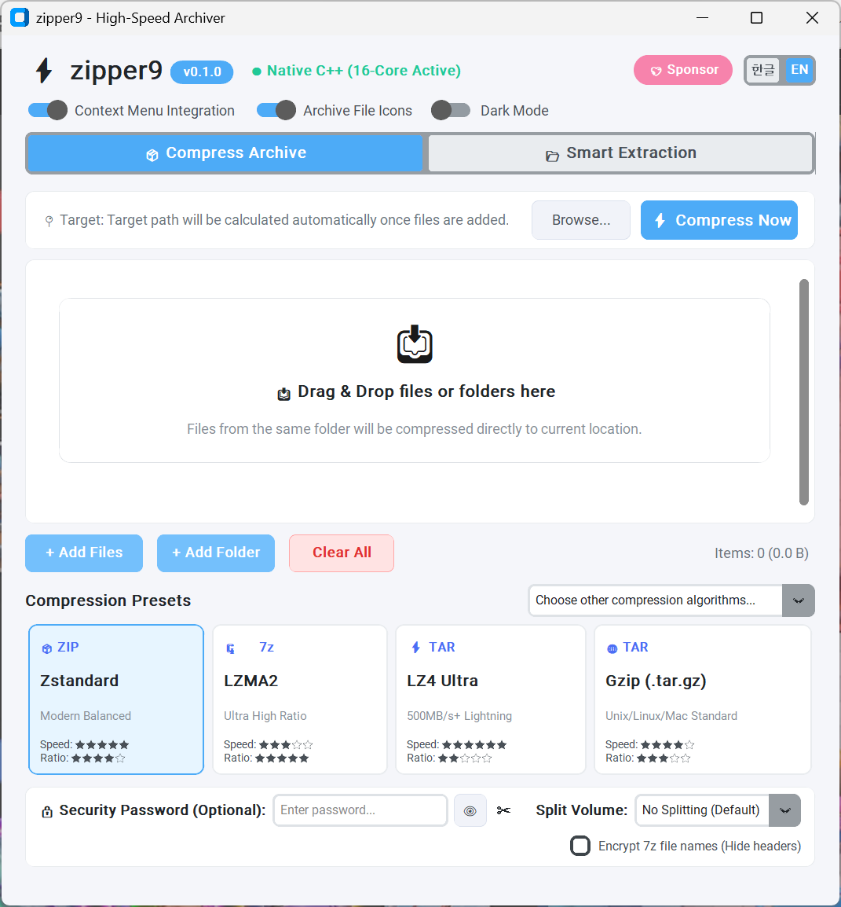
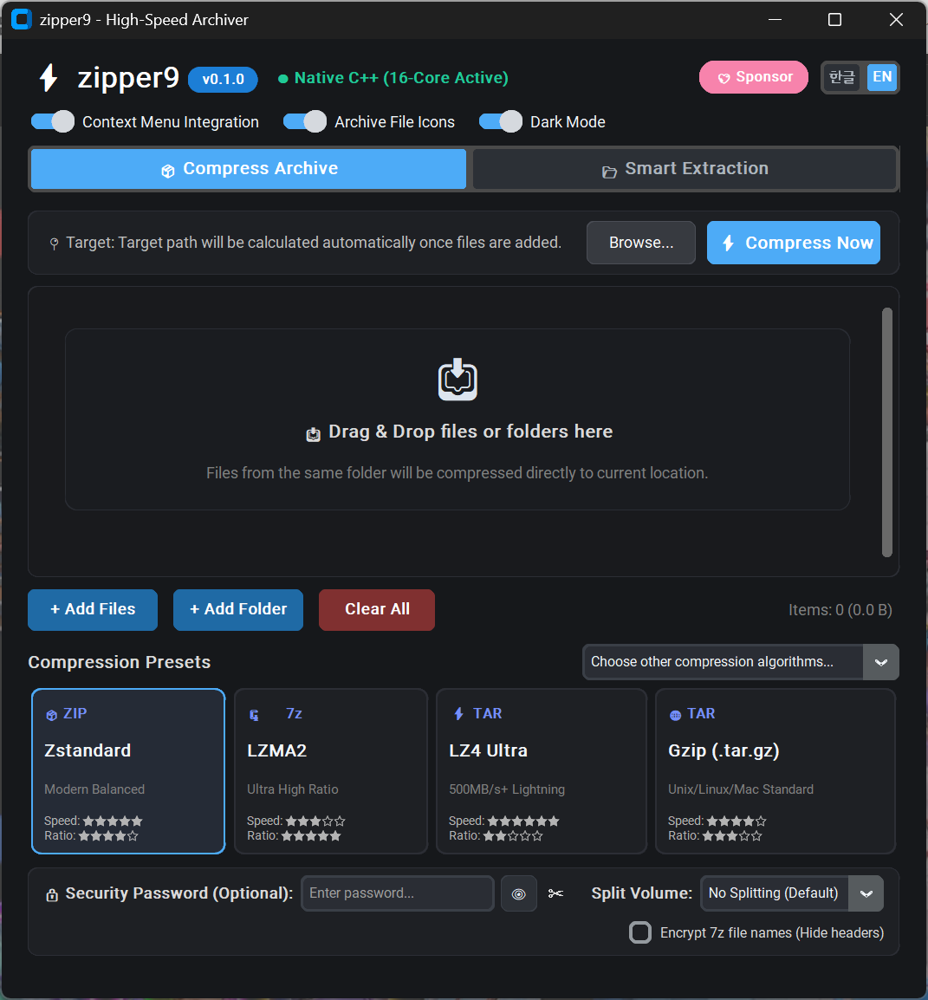

# zipper9 (Ultra-Lightweight Multi-Format Archiver) - v1.0.0

<div align="center">

<p>
  <b>English</b> • <a href="README.ko.md"><b>한국어 (Korean)</b></a>
</p>

[](LICENSE)
[](LICENSE)
[](#-quick-install--run)
[](#-support--sponsorship)

**Ultra-Lightweight & Blazing-Fast Cross-Platform Archiver powered by Native C/C++ Engines**  
*Compact bundle, Zstandard / LZ4 / LZMA2 multi-core compression, and modern Windows 11 shell integration.*

[Screenshots](#-screenshots) • [Key Features](#-key-features) • [Quick Install](#-quick-install--run) • [FAQ](#-faq--troubleshooting) • [Sponsor](#-support--sponsorship) • [License](#-license)

</div>

---

## 🌟 Key Features

### 🖥️ Screenshots

| Light Mode | Dark Mode |
| :---: | :---: |
|  |  |

1. **Ultra-Lightweight Modern UI (CustomTkinter)**:
   - Compact standalone bundle (~18MB), instant responsiveness, and polished Dark/Light theme support.
   - **Full Drag & Drop** for files and folders, and instant archive inspection for ZIP, 7z, and TAR archives.
   - Individual item removal with **`[✕]` button** directly from the source list.
   - **Real-time English / Korean language toggle** on the fly.
2. **Comprehensive Format & High-Speed Algorithm Support**:
   - **ZIP Archives (`.zip`)**:
     - `Zstandard (zstd)`: Meta's modern balanced high-speed & high-ratio algorithm (Default; 3-5x faster compression, 5-10x faster decompression than standard Deflate).
     - `Store (Uncompressed)`: Ultra-fast packaging within seconds for pre-compressed media files (videos, photos, archives).
   - **7-Zip Archives (`.7z`)**:
     - `7z: LZMA2 (Standard)`: Multi-threaded standard high-ratio compression powered by the native 7-Zip engine.
   - **TAR Archives (Unix / Linux / macOS Standard)**:
     - `TAR: .tar.lz4`: **LZ4 Ultra-Fast Archiving** (Decompression at RAM-bus speeds; ideal for large backups, VM disks, and game assets).
     - `TAR: .tar.gz`: Universal Unix/Linux/macOS standard tarball distribution format.
     - `TAR: .tar.xz`: Modern Linux kernel and packaging standard (XZ / LZMA2).
     - `TAR: .tar.bz2`: Classic Linux archive format (Bzip2).
     - `TAR: .tar`: Raw uncompressed tarball packaging.
3. **Archive Inspection & Safe Extraction**:
   - Real-time pre-extraction analysis: internal file tree, original size, compressed size, and savings percentage (%).
   - Built-in defenses against **Zip-Slip** and **Tar-Slip** path-traversal directory escape vulnerabilities.
   - Smart single-root folder extraction (Bandizip-style duplicate directory suppression).
4. **Post-Compression Integrity Verification**:
   - Enable **`[Verify integrity after compression]`** to automatically validate archive headers, CRC32/SHA checksums, and frame integrity immediately after compression via native 7-Zip (`7z t`) and LZ4 test routines.

---

## 📦 Multi-Platform Binaries

`zipper9` provides pre-built, ready-to-use binaries tailored for each desktop operating system.  
| Operating System | Package Format | Highlights & Integrations |
| :--- | :--- | :--- |
| **Windows 11 / 10** | `zipper9.exe`<br>`zipper9_shell.msix` | • Portable standalone binary (18MB, no installation required)<br>• Windows 11 modern top-level 1-click context menu (Rust COM DLL)<br>• Windows 10 classic context menu & file association icon binding |
| **Debian / Ubuntu / Raspberry Pi** | `zipper9_1.0.0_amd64.deb`<br>`zipper9_1.0.0_arm64.deb`<br>`zipper9-v1.0.0-linux-*.tar.gz` | • Native 64-bit x86_64 (`amd64`) and ARM64 (`arm64`, Raspberry Pi 4/5, Graviton) support<br>• 1-click `.deb` installation & standalone portable binaries<br>• Seamless integration with system packages (`7zip`, `lz4`, `zstd`)<br>• XDG desktop app launcher & file manager (Nautilus) integration |
| **macOS** | `zipper9-v1.0.0-macos.dmg`<br>`zipper9.app` | • Universal binary for Apple Silicon (M1~M4) & Intel Macs<br>• Standard `/Applications` drag & drop `.dmg` installer<br>• Homebrew Cask standalone recipe (`zipper9.rb`) support |

---

## 📁 Directory Structure

```text
zipper9/
├── requirements.txt            # Python runtime dependencies (CustomTkinter, darkdetect)
├── main.py                     # Application entry point
├── zipper9.rb                  # Standalone Homebrew Cask recipe (macOS)
├── zipper9.spec                # PyInstaller standalone bundling specification
├── run.bat                     # 1-click Windows launch script
├── tools/                      # 100% C/C++ native high-speed engine & shell extension bundles
│   ├── 7z/                     # 7-Zip multi-core engine (7z.exe, 7z.dll)
│   ├── lz4/                    # LZ4 high-throughput engine (lz4.exe)
│   ├── zstd/                   # Zstandard high-ratio engine (zstd.exe)
│   └── modern_shell/           # Windows 11 modern context menu shell extension bundle
├── assets/                     # 3D archive icons (.ico, .png)
├── images/                     # UI screenshots and previews
├── tests/                      # Headless multi-platform CI/CD test suite
└── zipper9_ui/                 # Python modern Fluent GUI
    ├── app.py                  # CustomTkinter main application
    └── bridge/                 # Worker, settings, i18n, and shell extension bridges
```

---

## 🚀 Quick Install & Run

Install and run zipper9 via a single command in your terminal across all supported operating systems.

### 1. Windows 11 / 10
- **WinGet Package Manager**:
  ```powershell
  winget install smin987.zipper9
  ```
- **CLI Terminal Launch (Opens GUI Window)**:
  ```powershell
  zipper9
  # Or open a specific file/folder directly in GUI
  zipper9 sample.zip
  zipper9 C:\data\my_folder
  ```
- **Portable Binary**: Download `zipper9.exe` directly from [GitHub Releases](https://github.com/smin987/zipper9/releases) and double-click to run.

### 2. Debian / Ubuntu / Raspberry Pi
- **APT One-Line Install (amd64)**:
  ```bash
  curl -sLO https://github.com/smin987/zipper9/releases/download/v1.0.0/zipper9_1.0.0_amd64.deb && sudo apt install -y ./zipper9_1.0.0_amd64.deb && rm zipper9_1.0.0_amd64.deb
  ```
- **APT One-Line Install (arm64 - Raspberry Pi 4/5, Graviton, Apple Silicon Linux VM)**:
  ```bash
  curl -sLO https://github.com/smin987/zipper9/releases/download/v1.0.0/zipper9_1.0.0_arm64.deb && sudo apt install -y ./zipper9_1.0.0_arm64.deb && rm zipper9_1.0.0_arm64.deb
  ```
- **Portable Binary (.tar.gz)**: Download architecture-specific `zipper9-v1.0.0-linux-*.tar.gz` from [GitHub Releases](https://github.com/smin987/zipper9/releases), extract and run `./zipper9` directly.
- **CLI Terminal Launch (Opens GUI Window)**:
  ```bash
  zipper9
  # Direct argument auto-binding
  zipper9 sample.zip
  zipper9 ./my_project
  ```

### 3. macOS (Apple Silicon & Intel)
- **Homebrew Cask (No separate tap repository required)**:
  ```bash
  brew install --cask https://raw.githubusercontent.com/smin987/zipper9/main/zipper9.rb
  ```
- **CLI Terminal Launch (Opens GUI Window)**:
  ```bash
  zipper9
  # Or standard macOS open command
  open -a zipper9
  ```
- **Direct DMG Installation**: Download `zipper9-v1.0.0-macos.dmg` from [GitHub Releases](https://github.com/smin987/zipper9/releases) and drag `zipper9.app` to `/Applications`.

---

## ❓ FAQ & Troubleshooting

### Q. [Windows] I deleted the portable `zipper9.exe` file directly, but the context menu items still appear.
**A.** This occurs because the shell extension was registered with the modern Windows 11 package and user registry.  
Even if you have already deleted the executable, open **PowerShell** and run the following single-line command to completely clean up all context menu entries and package registrations:

```powershell
Get-AppxPackage *zipper9* | Remove-AppxPackage -ErrorAction SilentlyContinue; Remove-Item -Path "HKCU:\Software\Classes\*\shell\zipper9_compress", "HKCU:\Software\Classes\Directory\shell\zipper9_compress", "HKCU:\Software\Classes\Directory\Background\shell\zipper9_open", "HKCU:\Software\zipper9" -Recurse -Force -ErrorAction SilentlyContinue
```

> *💡 On macOS and Linux, this issue does not occur as the OS automatically cleans up associations upon moving `zipper9.app` to Trash or uninstalling via `apt remove`.*

---

## 💖 Support & Sponsorship

`zipper9` is free software distributed under the **[Source-Available Freeware License](LICENSE)**.  
If you find this project valuable and wish to support its ongoing development and maintenance, consider buying me a coffee! Your support and encouragement are always greatly appreciated. ☕✨

<div align="center">

[](https://github.com/sponsors/smin987)
[](https://www.buymeacoffee.com/smin987)
[](https://ko-fi.com/smin987)

</div>

---

## 📜 License

`zipper9` is distributed under the **[zipper9 Fair-Code License Agreement](LICENSE)** (Source-Available & Freeware Software License).

- **Compiled Binaries**:
  - **100% Free** for personal, educational, non-profit, and **commercial / enterprise use**.
- **Individual Research & Contributions**:
  - Individual developers may freely inspect, study, and modify the source code locally for research, bug fixing, and submitting Pull Requests to the [official repository](https://github.com/smin987/zipper9).
- **No Competing Products**:
  - You may not use this source code or its derivatives to build, release, or distribute competing archiving/compression utility software or services.
- **No Modification by Commercial / Corporate Users**:
  - For-profit organizations, commercial entities, corporations, and enterprise users are strictly prohibited from modifying, altering, or patching the source code (commercial environments must strictly use official compiled binaries).
- **No Commercial Redistribution**:
  - You may not sell, rent, license, or commercially redistribute this software for profit.

For third-party open-source licenses (7-Zip, unRAR, LZ4, Zstandard), please refer to **[THIRD_PARTY_LICENSES.md](THIRD_PARTY_LICENSES.md)**.
- **RAR Format Notice**: `zipper9` does not create proprietary RAR archives; it only provides safe **extraction (decompression)** via the bundled 7-Zip engine.
